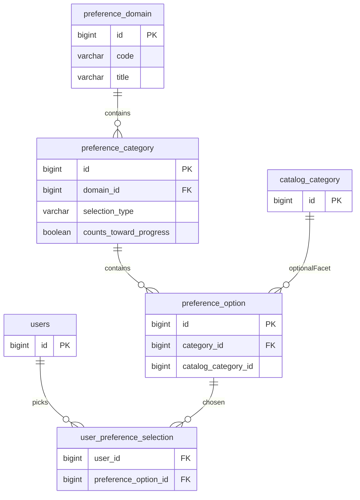

# Preferencije profila (Sephora-style) — baza, backend, frontend

## Kontekst u repou

- Korisnik je u tabeli [`users`](backend/src/main/resources/db/changelog/changes/03-auth.yaml) (`id`, `email`, `full_name`, …).
- Katalog već ima **stablo kategorija** koje se koriste kao facet filteri preko `categoryFacet` u [`PublicProductController`](backend/src/main/java/com/beautyhealth/catalog/api/PublicProductController.java) (npr. „tip kože“ kao roditelj, list kao deca — vidi migraciju [`14-tip-koze-under-lice.yaml`](backend/src/main/resources/db/changelog/changes/14-tip-koze-under-lice.yaml)).
- UI trenutno ima **statičan** progress u [`AccountMenuPopover.tsx`](storefront/src/components/AccountMenuPopover.tsx) (`w-[36%]`) i placeholder „Vaše beauty preference“ u [`ShopListingFilters.tsx`](storefront/src/components/ShopListingFilters.tsx).

**Ključna arhitektonska odluka:** preference profila nisu isto što i navigacija kataloga (Sephora ima npr. starosnu grupu, shopping preference, brendove — sve to ne mora biti isto kao facet čvor u stablu). Zato uvodimo **poseban takson** u bazi, sa **opcionim** FK ka `category.id` tamo gde opcija odgovara postojećem facet listu (npr. „Masna koža“) — tako se preporuke i „primeni moj tip kože na filter“ mogu povezati bez mešanja domena kataloga sa **domenom preferenci** (termin u nastavku).

---

## 1) Dizajn baze (PostgreSQL / Liquibase)

### Šta je `preference_domain` i zašto postoji

**Ime:** *domain* ovde nije „domen sajta“ u smislu DNS — nego **oblast preferenci** jedan nivo **iznad** `preference_category`: celokupan blok pitanja za jednu temu (npr. samo *Skincare / negu kože*, kasnije *Makeup*, *Hair*). Jedan red u `preference_domain` grupiše mnogo `preference_category` redova (akordeoni: Tip kože, Brige, Uzrast, …).

**Ovde nisu korisnički izbori** — `preference_domain`, `preference_category` i `preference_option` su zajedno **šabloni / lista mogućnosti** (obično iz seed-a). Reč „statički“ znači da ista struktura opcija važi za sve korisnike i ne nastaje tek u trenutku klika; **menja je održavanje sajta** (migracije, seed, kasnije moderatorski UI) — ne sam kupac. Šta je konkretan korisnik označio čuva se u **`user_preference_selection`** (`user_id` + `preference_option_id`).

- **Zašto nam treba poseban nivo iznad kategorije:** da URL, API (`?domain=skin_care`) i napredak `3/6` budu definisani **za tu oblast**, a ne za celu bazu odjednom; da kasnije dodavanje nove stranice preferenci bude novi red u `preference_domain` + novi seed kategorija, bez mešanja pravila napretka između različitih oblasti.
- **MVP pojednostavljenje:** ako dugo imate **samo jednu** stranicu, i dalje možete držati jedan seedovani domen (npr. `skin_care`); alternativa je jedna fiktivna tabela manje i `domain_id` kao kolona na kategoriji — plan preferira eksplicitnu tabelu radi Sephora-style više oblasti.

### Šta je `preference_category`

**Jedan red = jedan akordeon** na stranici tog domena (npr. „Tip kože“, „Brige za kožu“, „Uzrast“). `domain_id` kaže kojoj oblasti pripada (npr. samo negu kože). Unutra su konkretne **opcije** u tabeli `preference_option` (Mešovita, Suva, …).

- **`selection_type`:** `SINGLE` — korisnik bira jednu stvar u toj sekciji (često jedan „tip kože“); `MULTI` — može više (npr. više briga odjednom).
- **`counts_toward_progress`:** da li ta sekcija ulazi u broj **x/6** (ako je `false`, može biti opciona ili informativna sekcija koja ne pomera napredak).
- **`sort_order` / `is_active`:** redosled akordeona na UI i isključivanje bez brisanja podataka.

Korisnički izbori i dalje **nisu** u ovoj tabeli — ostaju u `user_preference_selection`, vezanih preko izabrane `preference_option`.

**Napomena o reči „statički“:** to **nije** odvojena tabela. `preference_domain` / `preference_category` / `preference_option` su zajedno **šablon** (isto za sve korisnike). **„Statički“** znači da se ove redove ne generiše iz korisnikovih klikova — već održavanjem. Jedina tabela koja drži **individualne izbore** je `user_preference_selection` (`user_id`).

Predložene tabele (snake_case, kao u ostatku projekta):

| Tabela | Svrha |

|--------|--------|

| `preference_domain` | Nivo **iznad** kategorije: oblast preferenci (jedna URL / jedan napredak `x/y`), npr. `skin_care` (Negu kože), kasnije `makeup`, `hair`. Polja: `id`, `code` (UK), `slug`, `title`, `sort_order`, `is_active`. |

| `preference_category` | Akordeon unutar domena (Tip kože, Brige, Uzrast, …): FK `domain_id`, `code`, `title`, `selection_type` (`SINGLE` \| `MULTI`), `sort_order`, `counts_toward_progress` (bool), `is_active`. |

| `preference_option` | Izbori unutar kategorije: FK `category_id`, `code`, `label`, `sort_order`, opciono `icon_url`, **opciono** `catalog_category_id` → `category(id)` (nullable) kada opcija = isti koncept kao facet u katalogu. |

| `user_preference_selection` | `(user_id, preference_option_id)` sa PK ili UNIQUE par; za `SINGLE` kategorije validacija u servisu (zameniti prethodne opcije iste kategorije). Kolona `updated_at` (opciono) za sortiranje. |

**Napredak (npr. 3/6):** za jedan `preference_domain`, broj kategorija gde je `counts_toward_progress = true` i gde korisnik ima **bar jedan** izabrani `preference_option` iz te kategorije, podeljeno sa ukupnim brojem takvih kategija. Isto pravilo kao Sephora „completed section“.

**Indeksi:** `(user_id)`, `(preference_option_id FK)`, `(user_id) + join na category` za brz pregled.

**Seed:** poseban Liquibase SQL/YAML (kao [`catalog-seed.sql`](backend/src/main/resources/db/changelog/sql/catalog-seed.sql)) koji puni domen „Negu kože“, kategorije i opcije (Tip kože: kombinovana, suva, …). Gde postoji odgovarajući čvor u `category`, popuniti `catalog_category_id` iz seed-a (jednokratan lookup po `slug`).

---

## 2) Backend (Spring Boot, vertical slice)

**Paket:** npr. `com.beautyhealth.preferences` (ili `profilepreferences`) — po uzoru na [`com.beautyhealth.catalog.api`](backend/src/main/java/com/beautyhealth/catalog/api/) i [`com.beautyhealth.auth`](backend/src/main/java/com/beautyhealth/auth/).

**Servis:**

- Učitavanje taksona po domenu (`code` ili `slug`).
- Čitanje izbora ulogovanog korisnika; spajanje u DTO: kategorija + označene opcije.
- **Upsert:** `PUT`/`PATCH` po domenu ili po kategoriji — body sa listom `optionId` po `categoryId`; za `SINGLE` zadržati najviše jednu opciju po kategoriji.
- **Progress:** izračunati u servisu i vratiti u odgovoru (`completedCount`, `totalCount`, opciono `percent`).

**REST (predlog putanja, usklađeno sa postojećim `/api/v1/auth/...`):**

| Metoda | Putanja | Pristup |

|--------|---------|---------|

| GET | `/api/v1/preferences/domains/{domainCode}` | **Javno** — samo definicija kategorija/opcija (bez korisničkih izbora). |

| GET | `/api/v1/auth/me/preferences?domain={domainCode}` | **JWT** — izbori + napredak za taj domen. |

| PUT | `/api/v1/auth/me/preferences/{domainCode}` | **JWT** — zamena izbora za ceo domen (ili varianta PATCH po kategoriji). |

**Bezbednost:** proširiti [`SecurityConfiguration`](backend/src/main/java/com/beautyhealth/config/SecurityConfiguration.java) da `GET /api/v1/preferences/**` bude `permitAll`, a `/api/v1/auth/me/preferences/**` zahteva autentikaciju (drugi put koristi isti prefiks kao postojeći `/me`).

**DTO:** stabilni `id` (Long) za opcije u JSON-u; bez eksponiranja internih joined tabela.

**Testovi:** bar jedan `@WebMvcTest` kontrolera (kao u [`PublicProductControllerWebMvcTest`](backend/src/test/java/com/beautyhealth/catalog/api/PublicProductControllerWebMvcTest.java)) + repository/service test za pravilo `SINGLE` i napredak.

---

## 3) Frontend (React / RTK Query)

**Stranica „Beauty preference“** (Sephora-paritet): breadcrumbs, naslov domena, **progress** `x/y`, lista **akordeona** po `preference_category`, unutra opcije kao kartice ili checkbox liste u zavisnosti od `selection_type`; dugme „Sačuvaj i nastavi“ koje čuva i otvara sledeći akordeon (lokalni state + poziv API-ja).

- **Rute:** npr. `/account/preferencije/:domainCode` ili `/account/beauty-preferences/:domainCode`; link iz [AccountMenuPopover](storefront/src/components/AccountMenuPopover.tsx) bloka „Preferencije i profil“.
- **API sloj:** proširenje [authEndpoints](storefront/src/features/api/authEndpoints.ts) ili novi `preferencesEndpoints.ts` sa `useGetPreferenceDomainQuery`, `useGetMePreferencesQuery`, `usePutMePreferencesMutation` (Bearer iz [authSession](storefront/src/lib/authSession.ts) / Redux token).
- **AccountMenuPopover:** zameniti fiksni `w-[36%] `**stvarnim** `percent` iz `GET .../auth/me/preferences` (ili kompaktnim `GET` samo za summary napretka ako želite manji payload — može biti isti endpoint sa `?summary=1`).

**Opciono (faza 2):** u [`ShopListingFilters.tsx`](storefront/src/components/ShopListingFilters.tsx) „Vaše beauty preference“ — kada korisnik ima sačuvan tip kože i `catalog_category_id`, predložiti checkbox „Primeni moje preference“ i mapirati na `categoryFacet` u URL-u listinga.

---

## Git: grana, push, PR, merge

Sva implementacija ovog plana radi se na **odvojenoj Git grani** (feature branch), ne direktno na `main` / `master` (ili ekvivalentnoj glavnoj grani tima).

1. **Kreirati granu** od ažurne glavne grane (npr. `feature/profile-preferences` ili `feat/beauty-preferences`).
2. **Commit-ovati** promene u skladu sa dogovorom tima (mali smisleni commiti po mogućstvu).
3. **Push** grane na `origin` (ili dogovoreni remote).
4. **Otvoriti pull request** (PR) prema glavnoj grani — opis promena, referenca na ovaj plan po potrebi.
5. **Revizija** (code review); ispravke po povratnoj informaciji na istoj grani, ponovni push koji ažurira PR.
6. **Merge PR-a** u glavnu granu nakon odobrenja (merge strategija po pravilima repoa: merge commit, squash, rebase).

Napomena: ako repo trenutno **nije** inicijalizovan kao git u ovom workspace-u, prvo ga povezati sa udaljenim repozitorijumom po uputstvima tima.

---

## Redosled isporuke

1. Liquibase šema + seed za jedan domen (npr. negu kože) + opcioni link ka `category` za tip kože.
2. Backend slice: entiteti, repozitorijumi, servis, kontroleri, bezbednost, testovi.
3. Storefront: stranica sa akordeonima, API, povezivanje progress bara u meniju naloga.

Ovime dobijate proširiv sistem (nove kategorije/opcije iz baze bez deploy-a fronta, osim ikona/UX copy-ja), jasno pravilo napretka kao na Sephori, i kasnije preporuke / filtere usklađene sa katalogom gde ima smisla.