# Plan: Uvodjenje messaging analytics sloja

## Cilj
- Uvesti `analytics events` kao prvi konkretan korak u učenju distribuiranih sistema: backend proizvodi događaje, Kafka ih prenosi, analytics servis ih konzumira i agregira, moderator ih prikazuje.
- Zadržati postojeći korisnički flow (cart/checkout/payment), bez blokiranja glavnih transakcija zbog analytics-a.

## Polazne tačke u postojećem kodu
- Checkout i kreiranje order-a su centralna tačka za poslovne događaje: [backend/src/main/java/com/beautyhealth/order/service/OrderService.java](backend/src/main/java/com/beautyhealth/order/service/OrderService.java).
- Bank webhook već centralizuje ishode plaćanja: [backend/src/main/java/com/beautyhealth/order/api/PaymentWebhookController.java](backend/src/main/java/com/beautyhealth/order/api/PaymentWebhookController.java).
- Cart akcije su već izdvojene i pogodne za event hook-ove: [backend/src/main/java/com/beautyhealth/cart/service/CartService.java](backend/src/main/java/com/beautyhealth/cart/service/CartService.java).
- Moderator API je mesto za agregirani prikaz metrika: [backend/src/main/java/com/beautyhealth/moderation/api/AdminOrderController.java](backend/src/main/java/com/beautyhealth/moderation/api/AdminOrderController.java).
- Moderator frontend već ima API sloj za nove endpoint-e: [moderator/src/features/api/baseApi.ts](moderator/src/features/api/baseApi.ts).
- Storefront već ima centralni RTK Query base za slanje frontend telemetry-ja: [storefront/src/features/api/baseApi.ts](storefront/src/features/api/baseApi.ts).

## Arhitektura (predloženi MVP)

```mermaid
flowchart LR
  storefront[StorefrontTelemetry] --> api[BeautyHealthAPI]
  api --> outbox[OutboxTable]
  outbox --> outboxPublisher[OutboxPublisher]
  outboxPublisher --> kafka[(KafkaTopics)]
  kafka --> analyticsConsumer[AnalyticsConsumerService]
  analyticsConsumer --> analyticsDb[(AnalyticsDB)]
  analyticsDb --> analyticsApi[AnalyticsReadAPI_ApiKey]
  analyticsApi --> moderatorApi[ModeratorAggregationEndpoints]
  moderatorApi --> moderatorUi[ModeratorDashboard]
```

## Faza 1: Event model i ugovor
- Definisati `event envelope` (npr. `eventId`, `eventType`, `occurredAt`, `source`, `actorType`, `actorId`, `correlationId`, `payload`, `schemaVersion`).
- Napraviti početni katalog događaja:
  - `cart_item_added`, `cart_item_updated`, `cart_item_removed`
  - `checkout_started`
  - `order_created`
  - `payment_authorized`, `payment_failed`, `payment_expired`
- Uvesti naming konvenciju topic-a (npr. `bh.analytics.events.v1`) i strategiju verzionisanja.

## Faza 2: Producer u postojećem backendu
- Dodati Kafka producer zavisnosti i konfiguraciju u [backend/build.gradle](backend/build.gradle) i `application*.yml` fajlove.
- Uvesti `AnalyticsEventPublisher` interfejs (domain-level) i Kafka implementaciju.
- Emitovati događaje iz:
  - [backend/src/main/java/com/beautyhealth/cart/service/CartService.java](backend/src/main/java/com/beautyhealth/cart/service/CartService.java)
  - [backend/src/main/java/com/beautyhealth/order/service/OrderService.java](backend/src/main/java/com/beautyhealth/order/service/OrderService.java)
  - [backend/src/main/java/com/beautyhealth/order/api/PaymentWebhookController.java](backend/src/main/java/com/beautyhealth/order/api/PaymentWebhookController.java)
- Da ne izgubimo događaje pri greškama/rollback-u, planirati Outbox pattern kao podrazumevani mehanizam (upis event-a u istoj transakciji, asinhroni publisher ka Kafki).

## Faza 3: Frontend telemetry ("self-hosted GA" sloj)
- Dodati lagani `analytics client` u storefront-u koji standardizuje UI event-e (page_view, product_view, add_to_cart_click, checkout_open).
- Slanje frontend event-a na backend endpoint `/api/v1/analytics/events` (bulk + retry), backend ih takođe mapira u isti Kafka tok.
- Voditi računa o privatnosti: bez PII u payload-u; `userId` samo ako je auth, za goste anonimni/session identifikator.

## Faza 4: Analytics mikroservis (consumer + read API)
- Novi servis (`analytics-service`) konzumira topic i čuva:
  - raw event store (audit/replay),
  - agregate po danu/satu (orders, conversion, payment success/fail po metodi, revenue).
- Implementirati idempotentnu obradu (`eventId` unique constraint + dedup).
- Dodati API-key auth za read endpoint-e (npr. `X-API-Key`) i endpoint-e:
  - `/api/v1/reports/kpi-summary`
  - `/api/v1/reports/payments`
  - `/api/v1/reports/funnel`

## Faza 5: Integracija sa moderator panelom
- U postojećem backend-u dodati "aggregation/proxy" endpoint-e za moderator UI (bez direktnog izlaganja analytics servisa browser-u).
- Backend prema analytics servisu šalje API key server-to-server.
- U moderator app-u dodati novu dashboard sekciju i RTK Query endpoint-e za KPI kartice i trendove.

## Faza 6: Operativni standardi i učenje kroz eksperimente
- Uvesti observability minimum: producer/consumer lag, dead-letter topic, broj nevalidnih događaja.
- Definisati SLA očekivanja (eventual consistency prozor npr. 5-30s).
- Pripremiti 2-3 hipoteze za učenje (npr. "drop u funnel-u na payment redirect-u", "COD vs CARD success rate").

## Test i validacija plan
- Contract test za event schema (`json schema`/`avro` validacija).
- Integracioni test producer->Kafka->consumer sa Testcontainers.
- E2E scenario: `add_to_cart -> create_order -> webhook AUTHORIZED/FAILED` i provera da su agregati ažurirani.
- Failure scenariji: dupliran webhook, Kafka privremeno nedostupan, consumer restart.

## Predloženi redosled realizacije (2 sprinta)
- Sprint 1: event model, backend producer + outbox, ključni business event-i (cart/order/payment).
- Sprint 2: analytics-service consumer + read API key auth + moderator dashboard MVP.

## Napomene
- Ovaj plan favorizuje pouzdanost (Outbox) u odnosu na najbrže "direktno publish" rešenje, jer je cilj učenja messaging-a sa realnim failure mode-ovima.
- Nakon MVP-a sledeći korak je proširenje na dodatne domene (`auth`, `reviews`, `content engagement`) i naprednije stream obrade.