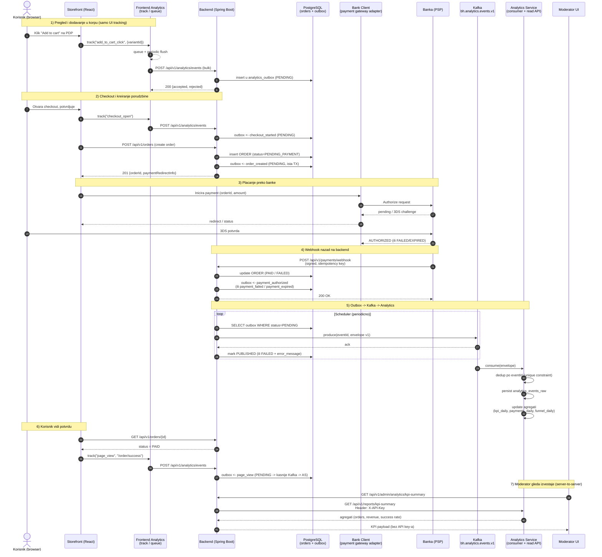

Evo Mermaid sequence dijagrama koji pokriva ceo tok kupovine + analitike, baš onako kako je dizajnirano u ovih 6 tiketa:

Kako se mapira na tikete:

- Korak 1, 6 i `POST /api/v1/analytics/events` = Ticket 3 (storefront telemetry + ingest)
- Outbox upis u istoj transakciji + scheduler -> Kafka = Ticket 2 (backend producer + outbox)
- Konzumacija, dedup, agregati, `X-API-Key` read API = Ticket 4 (analytics service)
- Moderator -> backend -> analytics-service (browser ne vidi API key) = Ticket 5
- Format envelope-a (`eventId`, `eventType`, `schemaVersion=v1`, topic `bh.analytics.events.v1`) = Ticket 1
- Idempotencija webhooka, dedup `eventId`, Kafka outage = Ticket 6 (failure scenariji)

Par stvari koje su namerno tako nacrtane:

- Banka pravi `payment_authorized/failed/expired` event preko `PaymentWebhookController`, ne direktno frontend - to je single source of truth za plaćanje.
- Frontend telemetry i backend business event-i završavaju u **istom** `analytics_outbox` -> isti Kafka topic -> isti consumer, što je tačno ono što Ticket 3 traži ("Backend mapira primljene event-e u isti outbox tok iz Ticketa 2").
- Moderator nikad ne ide direktno na `analytics-service` (Ticket 5: "API key nikad ne sme ici u browser").