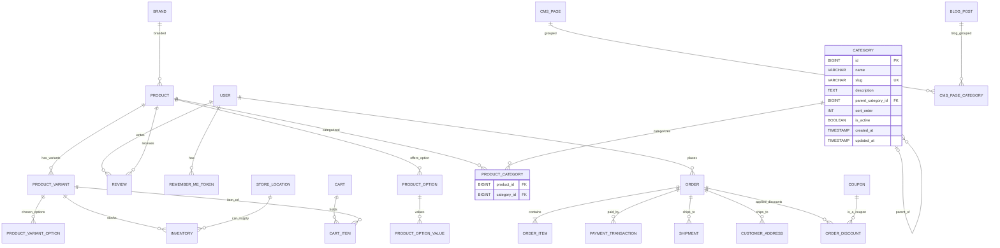

# Referentni ER model (baza) — beauty-health

Ovaj dijagram je **ciljna šema** za Liquibase changeset-e kroz backend tikete (B01–B11). Atributi entiteta dopunjavaju se u tiketima gde se entitet uvodi; ovde su odnosi i (gde je poznato iz izvora) ključna polja.

## Napomene za agenta

- Imena tabela u bazi: konvencija `snake_case` (npr. `product_variant`, `cart_item`).
- `STORE_LOCATION` u modelu = fizička lokacija zalihe; **lokacije prodavnica** za CMS mogu biti odvojena tabela ili deo `CMS_PAGE` — uskladiti sa B09/M05.
- `ORDER_DISCOUNT` / `COUPON`: proširiti u B07 kada proizvod definiše kupone; do tada stub ili izostaviti.
- Svaki backend tiket koji dodaje tabele mora imati **Liquibase changeset** idempotentan po verziji (`changeset id="..." author="..."`).
