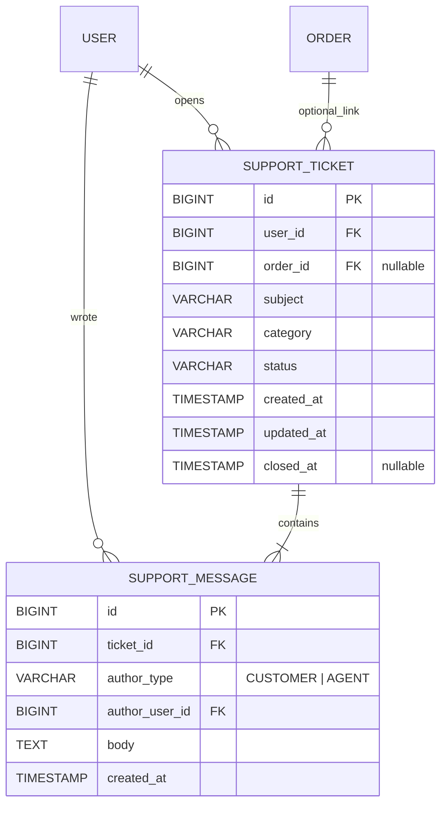

# Specifikacija — Korisnička podrška (tiketi)

**Modul:** online podrška za kupce + agent panel u moderator aplikaciji  
**Verzija:** 1.0 (MVP)  
**Status:** spremno za implementaciju  
**Repozitorijum:** `beauty-health` (backend + storefront + moderator)

---

## 1. Cilj

Omogućiti **ulogovanim kupcima** da otvaraju zahteve za podršku, prate razgovor i odgovaraju agentu. Omogućiti **moderatorima** da vide inbox zahteva, odgovaraju i upravljaju statusom.

Ovo **nije** specifikacija celog projekta — samo slice **support tickets**. Pretpostavlja postojeće: autentikacija (JWT), tabela `users`, tabela `orders`, moderator shell, storefront sekcija „Moj nalog”.

---

## 2. Opseg

### U opsegu (MVP)

| Sloj | Šta |
|------|-----|
| **Baza** | Tabele `support_ticket`, `support_message` |
| **Backend** | REST API za kupca (`/api/v1/auth/me/...`) i agenta (`/api/v1/admin/...`) |
| **Storefront** | Stranice u `/account/podrska` — lista, novi zahtev, detalj + odgovor |
| **Moderator** | Inbox tiketa + detalj sa odgovorom i promenom statusa |
| **Integracija** | Dugme „Prijavi problem” na detalju porudžbine; link sa CMS stranice Kontakt |

### Van opsega (MVP)

- Prilozi (slike, PDF)
- Email / push notifikacije
- Dodela tiketa konkretnom agentu (`assignedTo`)
- Interni tiketi bez učešća kupca (agent-only)
- AI / chatbot odgovori
- Gost forma bez naloga (gosti koriste email iz footera / CMS Kontakt)

### Postojeće — ne dirati u ovom tiketu

- `/users/support` u moderatoru (pretraga korisnika po email/ID) — **ostaje** kao pomoćni alat
- CMS stranica `/pages/kontakt` — samo dodati link ka `/account/podrska` (copy, ne nova forma)

---

## 3. Poslovna pravila

### 3.1 Ko sme da otvara zahtev

- Samo **ulogovani** korisnici sa ulogom `CUSTOMER`.
- Gost → redirect na login sa `returnUrl=/account/podrska`.
- Email i ime **ne** unosi u formi — uzimaju se iz profila (`users`).

### 3.2 Struktura zahteva

- **Jedan zahtev = jedna tema** (naslov + kategorija) + **niz poruka** (thread).
- Prva poruka kupca kreira se **istovremeno** sa zahtevom (jedan `POST`, ne dva koraka).
- Kupac **ne menja** naslov ni kategoriju posle kreiranja (MVP).

### 3.3 Statusi

| Status | Značenje |
|--------|----------|
| `OPEN` | Novi zahtev, čeka odgovor agenta. Podrazumevano pri kreiranju. |
| `WAITING_CUSTOMER` | Agent je odgovorio; čeka se kupac. |
| `RESOLVED` | Smatrano rešenim; kupac i dalje **može** da odgovori. |
| `CLOSED` | Zatvoreno; **read-only** — nema novih poruka. |

**Pravila:**

- Samo **agent** menja status (`PATCH`).
- Kupac može dodavati poruke dok status **nije** `CLOSED`.
- Kada kupac odgovori na tiket u statusu `WAITING_CUSTOMER` ili `RESOLVED`, backend **automatski** postavlja status na `OPEN` (agent treba ponovo da reaguje).

### 3.4 Kategorije (enum)

| Kod | Opis (UI) |
|-----|-----------|
| `DELIVERY` | Isporuka |
| `PAYMENT` | Plaćanje / refund |
| `PRODUCT` | Proizvod |
| `ORDER` | Porudžbina (izmena, otkazivanje) |
| `ACCOUNT` | Nalog i podaci |
| `OTHER` | Ostalo |

### 3.5 Validacija polja

| Polje | Pravilo |
|-------|---------|
| `subject` | obavezno, 5–120 karaktera |
| `category` | obavezno, jedna od enum vrednosti |
| `body` (poruka) | obavezno, 20–4000 karaktera |
| `orderId` | opciono; ako je prosleđen, mora pripadati `user_id` zahteva — inače **400** |

### 3.6 Rate limiting

- Max **5 novih zahteva po korisniku u 1 satu** (429 ako prekoračen).
- Max **20 poruka po korisniku u 1 satu** na svim tiketima (429).

---

## 4. Korisnički tokovi

### 4.1 Kupac — novi zahtev (opšti)

```
/account/podrska → „Novi zahtev”
  → forma (kategorija, naslov, poruka, opciono narudžbina)
  → POST kreira ticket + prvu poruku
  → redirect /account/podrska/:ticketId
```

### 4.2 Kupac — sa detalja porudžbine

```
/account/porudzbina/:orderId → „Prijavi problem”
  → /account/podrska/novi?orderId=:orderId
  → orderId unapred popunjen (readonly)
  → kategorija podrazumevano ORDER (korisnik može promeniti)
```

### 4.3 Kupac — odgovor

```
/account/podrska/:ticketId
  → prikaz thread-a
  → ako status ≠ CLOSED: textarea + „Pošalji”
  → POST poruka (authorType CUSTOMER)
```

### 4.4 Agent — rešavanje

```
Moderator → Podrška → Tiketi (/support/tickets)
  → filter po statusu / kategoriji / datumu
  → otvori tiket (/support/tickets/:id)
  → vidi korisnika, opcionu narudžbinu, thread
  → odgovor + opciono promena statusa
  → zatvaranje → CLOSED
```

### 4.5 Kontakt stranica (CMS)

Na postojećoj stranici Kontakt dodati tekstualni link:  
**„Prijavite se za online podršku”** → `/account/podrska`.

---

## 5. ER model

Dopuna referentnog modela u [`../DATA_MODEL.md`](../DATA_MODEL.md).



### 5.1 Tabela `support_ticket`

| Kolona | Tip | Napomena |
|--------|-----|----------|
| `id` | BIGINT PK, auto | |
| `user_id` | BIGINT FK → `users.id` | NOT NULL |
| `order_id` | BIGINT FK → `orders.id` | NULL |
| `subject` | VARCHAR(120) | NOT NULL |
| `category` | VARCHAR(32) | NOT NULL, enum |
| `status` | VARCHAR(32) | NOT NULL, default `OPEN` |
| `created_at` | TIMESTAMP | NOT NULL |
| `updated_at` | TIMESTAMP | NOT NULL |
| `closed_at` | TIMESTAMP | NULL; setovati kad status → `CLOSED` |

**Indeksi:**

- `idx_support_ticket_user_id` (`user_id`)
- `idx_support_ticket_status_created` (`status`, `created_at DESC`)
- `idx_support_ticket_order_id` (`order_id`) — opciono, WHERE order_id IS NOT NULL

### 5.2 Tabela `support_message`

| Kolona | Tip | Napomena |
|--------|-----|----------|
| `id` | BIGINT PK, auto | |
| `ticket_id` | BIGINT FK → `support_ticket.id` | NOT NULL, ON DELETE CASCADE |
| `author_type` | VARCHAR(16) | `CUSTOMER` ili `AGENT` |
| `author_user_id` | BIGINT FK → `users.id` | NOT NULL |
| `body` | VARCHAR(4000) | NOT NULL |
| `created_at` | TIMESTAMP | NOT NULL |

**Indeks:** `idx_support_message_ticket_created` (`ticket_id`, `created_at ASC`)

### 5.3 Liquibase

- Fajl: `backend/src/main/resources/db/changelog/changes/15-support-tickets.yaml`
- Uključiti u `db.changelog-master.yaml`
- Changeset id: npr. `b15-create-support-tickets`

---

## 6. Backend API

**Paket:** `com.beautyhealth.support` (vertical slice: `domain`, `repo`, `service`, `api`, `api/dto`)

**Konvencije:** iste kao ostatak repoa — JSON, `ApiError` za greške, OpenAPI anotacije na kontrolerima.

### 6.1 Kupac — autentifikovani endpointi

Prefiks: `/api/v1/auth/me/support-tickets`  
Zahteva: JWT, korisnik vidi **samo svoje** tikete.

| Metoda | Putanja | Opis |
|--------|---------|------|
| `GET` | `/` | Lista tiketa trenutnog korisnika. Query: `page`, `size`, opciono `status`. Sort: `createdAt,desc`. |
| `POST` | `/` | Kreira tiket + prvu poruku. Telo: `CreateSupportTicketRequest`. Odgovor: `201` + `SupportTicketDetailDto`. |
| `GET` | `/{ticketId}` | Detalj + sve poruke (sort `createdAt,asc`). **404** ako tiket nije korisnikov. |
| `POST` | `/{ticketId}/messages` | Nova poruka kupca. Telo: `{ "body": "..." }`. **409** ako je `CLOSED`. |

**Primer `CreateSupportTicketRequest`:**

```json
{
  "subject": "Paket nije stigao",
  "category": "DELIVERY",
  "body": "Porudžbina je plaćena pre 10 dana...",
  "orderId": 42
}
```

### 6.2 Agent — admin endpointi

Prefiks: `/api/v1/admin/support-tickets`  
Zahteva: `ROLE_MODERATOR` (postojeća Spring Security pravila za `/api/v1/admin/**`).

| Metoda | Putanja | Opis |
|--------|---------|------|
| `GET` | `/` | Lista svih tiketa. Query: `page`, `size`, `status`, `category`, `userId`, `from`, `to` (ISO instant). |
| `GET` | `/{ticketId}` | Detalj + poruke + **kupčevi podaci** (id, email, fullName). |
| `POST` | `/{ticketId}/messages` | Odgovor agenta. Telo: `{ "body": "..." }`. `authorType` = `AGENT` na serveru. |
| `PATCH` | `/{ticketId}/status` | Telo: `{ "status": "WAITING_CUSTOMER" }`. Validirati dozvoljene prelaze (v. 6.4). |

### 6.3 DTO polja (javni ugovor)

**`SupportTicketSummaryDto`** (lista):

- `id`, `subject`, `category`, `status`, `createdAt`, `updatedAt`
- `messageCount` (opciono, za preview)
- `orderId` (nullable)

**`SupportTicketDetailDto`** (detalj):

- sva polja iz summary +
- `messages`: niz `{ id, authorType, authorDisplayName, body, createdAt }`
- za admin: `customer`: `{ id, email, fullName }`

**Napomena:** u kupčevom API-ju **ne vraćati** tuđe PII; `authorDisplayName` za agenta može biti fiksno „Podrška Beauty Health”.

### 6.4 Prelazi statusa (agent PATCH)

Dozvoljeno (MVP — fleksibilno, ali validirati na serveru):

- `OPEN` → `WAITING_CUSTOMER`, `RESOLVED`, `CLOSED`
- `WAITING_CUSTOMER` → `OPEN`, `RESOLVED`, `CLOSED`
- `RESOLVED` → `OPEN`, `CLOSED`
- `CLOSED` → (nema promene poruka; eventualno samo `OPEN` ako product kasnije traži „reopen” — **MVP: CLOSED je finalan**)

Pri prelasku u `CLOSED`: postaviti `closed_at = now()`.

### 6.5 HTTP kodovi

| Situacija | Kod |
|-----------|-----|
| Uspeh kreiranja | 201 |
| Neautorizovan | 401 |
| Tuđi tiket / nije MODERATOR | 403 |
| Nepostojeći tiket | 404 |
| Validacija / pogrešan orderId | 400 |
| Poruka na CLOSED tiket | 409 |
| Rate limit | 429 |

### 6.6 Testovi (minimum)

- `@WebMvcTest`: kupac ne može `GET` tuđi tiket (404 ili 403)
- `@WebMvcTest`: moderator može listu; CUSTOMER na admin rutu → 403
- `@WebMvcTest`: POST poruka na CLOSED → 409
- Servisni test: kreiranje tiketa + prva poruka u jednoj transakciji
- Servisni test: `orderId` koji ne pripada korisniku → 400

---

## 7. Storefront (kupac)

**Aplikacija:** `storefront/`  
**Auth:** postojeći `RequireAuth` + RTK Query (`baseApi`).

### 7.1 Rute

| Ruta | Komponenta | Opis |
|------|------------|------|
| `/account/podrska` | `AccountSupportListPage` | Tabela/kartice tiketa, CTA „Novi zahtev” |
| `/account/podrska/novi` | `AccountSupportCreatePage` | Forma; query `orderId` opciono |
| `/account/podrska/:ticketId` | `AccountSupportDetailPage` | Thread + odgovor |

Dodati **NavLink** „Podrška” u `AccountLayout` sidebar (pored Porudžbina).

### 7.2 UI zahtevi

- Jezik: **srpski** (UI copy: „zahtev”, ne „ticket”).
- Prazna lista: poruka + dugme „Novi zahtev”.
- Lista: naslov, kategorija (lokalizovan label), status (badge), datum.
- Forma: react-hook-form + Zod (kao ostatak storefront-a).
- Detalj porudžbine: link/dugme **„Prijavi problem”** → `/account/podrska/novi?orderId=...`.
- Greške: `parseApiError` + banner (postojeći obrazac).

### 7.3 API klijent

- Fajl: `storefront/src/features/api/supportEndpoints.ts` (ili `supportTicketEndpoints.ts`)
- Registrovati u `store.ts` (inject endpoints)
- Tagovi RTK Query: `SupportTicket` sa `LIST` i po `id`

---

## 8. Moderator (agent panel)

**Aplikacija:** `moderator/`  
**Port:** 5174 (postojeći).

### 8.1 Rute (novi modul)

| Ruta | Komponenta | Opis |
|------|------------|------|
| `/support/tickets` | `SupportTicketsListPage` | Inbox |
| `/support/tickets/:id` | `SupportTicketDetailPage` | Detalj + odgovor |

Dodati stavku **„Podrška”** u `ModeratorShell` sidebar (ne mešati sa `/users/support` — to je pretraga korisnika).

### 8.2 UI zahtevi

- **Lista:** filter status, kategorija; kolone: ID, naslov, kupac (email), status, kategorija, datum, orderId (link).
- **Detalj:**
  - PII banner (isti ton kao `UsersLayout` — GDPR upozorenje).
  - Podaci kupca: id, email, ime.
  - Ako postoji `orderId`: link na `/orders/:orderId`.
  - Thread poruka (vizuelno razlikovati CUSTOMER vs AGENT).
  - Forma odgovora + `<select>` status + dugme „Sačuvaj status”.
- Greške: `ApiErrorBanner` / `parseApiError`.

### 8.3 API klijent

- Proširiti ili dodati: `moderator/src/features/api/supportTicketEndpoints.ts`
- Ne mešati sa postojećim `supportEndpoints.ts` (recenzije + user lookup) — ili jasno imenovati exporte.

---

## 9. Bezbednost i privatnost

- Kupčev API filtrira po `user_id` iz JWT — **nikad** trust `userId` iz query-ja na kupčevim rutama.
- Admin API: samo `ROLE_MODERATOR`.
- Email kupca vidljiv **samo** u admin detalju, ne u javnom API-ju.
- Logovi: ne logovati pun `body` poruka na INFO nivou (PII).

---

## 10. Kriterijumi prihvatanja (MVP)

### Backend

- [ ] Liquibase migracija kreira tabele i indekse.
- [ ] Kupac može kreirati zahtev, videti listu, otvoriti detalj, poslati poruku.
- [ ] Kupac ne vidi tuđe zahteve.
- [ ] Agent vidi sve zahteve, odgovara, menja status.
- [ ] `orderId` validacija radi.
- [ ] Poruke na `CLOSED` tiketu odbijene (409).
- [ ] Rate limit implementiran ili dokumentovan stub sa TODO na B12 nivou.

### Storefront

- [ ] Rute `/account/podrska/*` rade za ulogovanog kupca.
- [ ] Gost se redirectuje na login.
- [ ] „Prijavi problem” sa detalja porudžbine prenosi `orderId`.
- [ ] Forma validira dužine polja pre slanja.

### Moderator

- [ ] `/support/tickets` lista sa filterima.
- [ ] Detalj prikazuje thread, kupca, link na narudžbinu.
- [ ] Agent može odgovoriti i zatvoriti tiket.
- [ ] PII banner prisutan na detalju.

### Integracija

- [ ] E2E ili ručni test plan: kupac otvori → agent odgovori → kupac odgovori → agent zatvori.

---

## 11. Redosled implementacije

1. ER dopuna u `junior-tickets/DATA_MODEL.md`
2. Liquibase `15-support-tickets.yaml`
3. Backend: domain → repo → service → controller → testovi
4. Moderator: API endpoints → lista → detalj → navigacija
5. Storefront: API endpoints → rute → layout link → stranice → dugme na porudžbini
6. Ručni/E2E test plan

---

## 12. Reference u repou

| Šta | Gde |
|-----|-----|
| Postojeća pretraga korisnika (agent) | `moderator/.../UserSupportPage.tsx`, `AdminUserController` |
| Obrazac naloga (storefront) | `storefront/src/layouts/AccountLayout.tsx` |
| Security admin rute | `backend/.../SecurityConfiguration.java` |
| Primer slice-a (recenzije) | `backend/.../review/`, `junior-tickets/backend/08-slice-recenzije.md` |
| ER referenca | `junior-tickets/DATA_MODEL.md` |

---

## 13. Otvorena pitanja (za product owner pre koda)

| # | Pitanje | Predlog u ovoj specifikaciji |
|---|---------|------------------------------|
| 1 | Kupac piše u `RESOLVED`? | Da |
| 2 | Reopen iz `CLOSED`? | Ne u MVP |
| 3 | Automatski `OPEN` kad kupac odgovori? | Da |
| 4 | Prikaz imena agenta kupcu? | Fiksno „Podrška Beauty Health” |

Ako product owner promeni odluku, ažurirati ovaj dokument pre implementacije.
